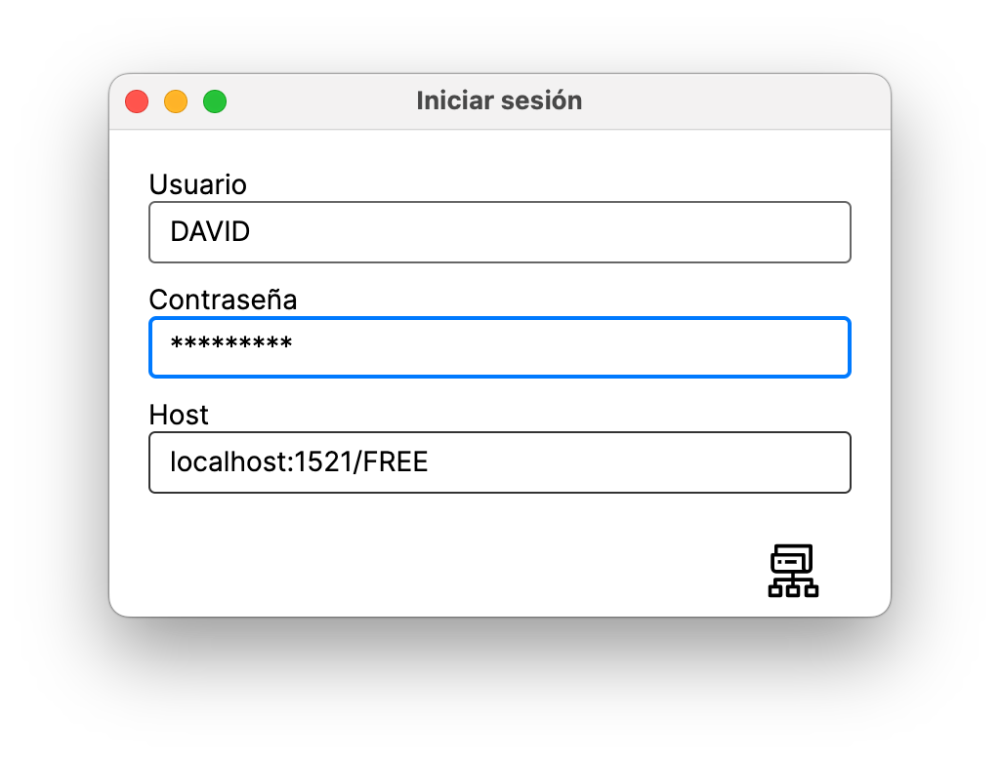
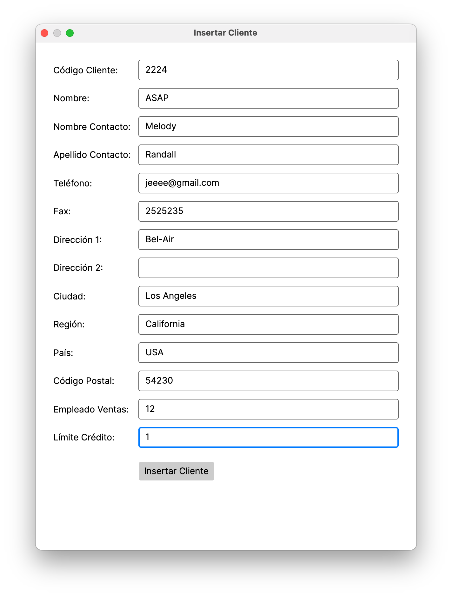
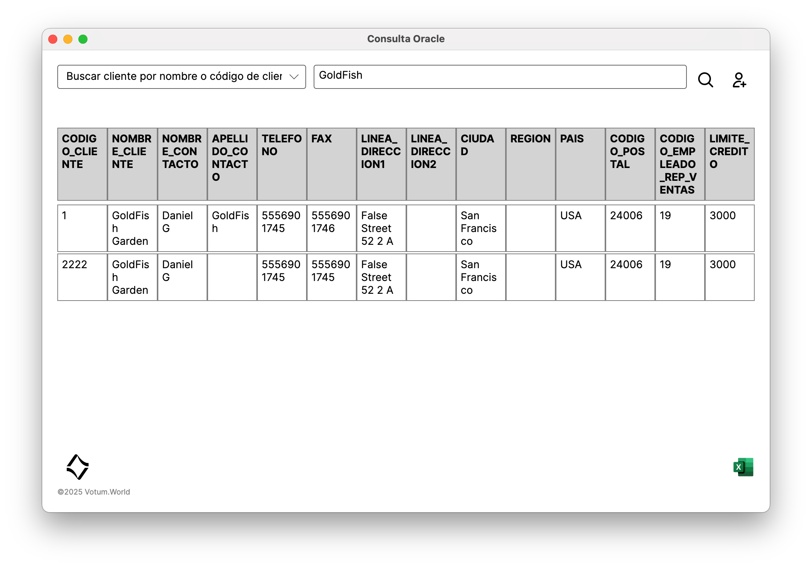

# OracleManager

  

Cross-platform desktop application for operational and commercial management, built with .NET 9 and Avalonia. Connects to Oracle Database with native OS credential storage on both macOS and Windows.

**Developed during a professional internship — before starting any formal software engineering studies — in a production environment with real operational constraints.**

---

## Screenshots

<p align="center">
  
  <br>
  <sub>Main view — dynamic search, inline table results and Excel export.</sub>
</p>

<p align="center">
  
  <br>
  <sub>Login — OS credential storage via macOS Keychain.</sub>
</p>

<p align="center">
  
  <br>
  <sub>Client insertion form with live data.</sub>
</p>
---

## What this project does

OracleManager is an internal tool used to manage clients, orders, payments and employees against an Oracle database. It runs natively on macOS and Windows from a single C# codebase, stores credentials securely in the OS keychain (macOS) or Credential Manager (Windows), and provides a dynamic query interface with inline editing, filtering and Excel export.

---

## Stack

| Component | Technology |
|---|---|
| Language | C# / .NET 9.0 |
| UI | Avalonia 11.3.3 |
| Database | Oracle (`Oracle.ManagedDataAccess.Core` 23.9.1) |
| Credential storage | macOS Keychain / Windows Credential Manager |
| DI | `Microsoft.Extensions.DependencyInjection` |
| Architecture | MVVM + service layer + DAO |

---

## Key technical decisions

**Native OS credential storage**
Credentials are never stored in plain text or in the application config. On macOS they go to the system Keychain, on Windows to the Credential Manager. The same `Manager.cs` handles both platforms via compile-time directives.

**Parameterized SQL throughout**
All user-supplied values go through Oracle parameters, not string interpolation. Dynamic identifiers (table/column names) are validated against an explicit whitelist before being included in queries.

**Audit logging**
All connection attempts (success and failure) are logged via `IAuditLogger` without ever writing credentials or full connection strings to disk.

**Environment-based configuration**
```bash
export DB_USER="your_user"
export DB_HOST="host:1521/FREE"
export DB_PASSWORD="your_password"
```

---

## Running locally

Requires .NET 9 SDK and access to an Oracle instance.

```bash
dotnet restore
dotnet build
dotnet run
```

> **macOS users:** Oracle Database does not provide a native ARM image. Setting up Oracle locally on Apple Silicon requires Colima. See the [Oracle DB on macOS setup guide](https://github.com/davidrlopez/OracleDBmacOS) for a complete walkthrough.

---

## Security hardening applied

This repo went through a post-development security audit. Changes applied:

- Removed all hardcoded credentials from source and test files
- Removed full connection string from debug logs
- Removed insecure host/user defaults from DI registration
- Migrated INSERT operations from `ExecuteQuery` to `ExecuteNonQuery`
- Added identifier whitelist validation for dynamic SQL (table/column names)
- Cleaned build artifacts, IDE files and runtime logs from repo history

---

## Known limitations and roadmap

The main view controller is the largest file and concentrates too much logic. It works but is the main source of technical debt. Planned refactor: extract query, pagination, inline edit, export and delete flows into dedicated services.

No automated tests or CI pipeline exist in this state. Next steps would be unit tests for the service layer and a GitHub Actions pipeline for build + static analysis.

---

## Context

Built in 3 weeks during a professional internship, self-taught, in a company with no software engineering background. The goal was to solve real operational needs while learning applied software engineering from scratch.

**Infrastructure constraints and problem-solving:**
Since the company lacked a dedicated server, an obsolete 2011 iMac was repurposed. Using OpenCore Legacy Patcher, it was upgraded to macOS Sonoma to support modern containerization. This machine was deployed as an on-premise company server running an Oracle SQL database via Docker, which was administered remotely via SSH and `sqlcl`.

The original codebase had hardcoded credentials and insecure logging practices — a common constraint when working in environments where security is not a primary concern. The audit and hardening process was applied afterwards as a learning exercise and to make the code suitable for a public portfolio.

---

## Contributors

**Jesús Francisco Espinosa Sánchez** ([@hir0krim](https://github.com/hir0krim))
- Implemented deep link / meta-link navigation support within the Avalonia application
- Co-designed the entity-relationship model for the database schema, including field definition and mapping to the UI layer
- Conducted exploratory and stress testing to identify functional defects and improve application robustness

**Moira Perez Rodriguez** ([@Moipr99](https://github.com/Moipr99))
- Engineered data preprocessing pipelines to clean and migrate legacy data into the Oracle database, ensuring schema integrity and optimized query performance
- Implemented compatibility with Windows Hello and Windows Credential Manager, enabling secure application access via OS-level PIN and system credentials
- Co-developed the authentication bridge for the desktop application, specifically handling the integration with Windows Security APIs to complement the macOS Keychain implementation
